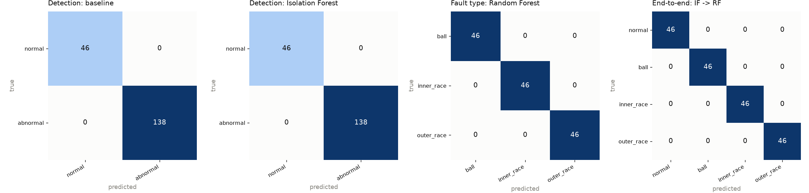
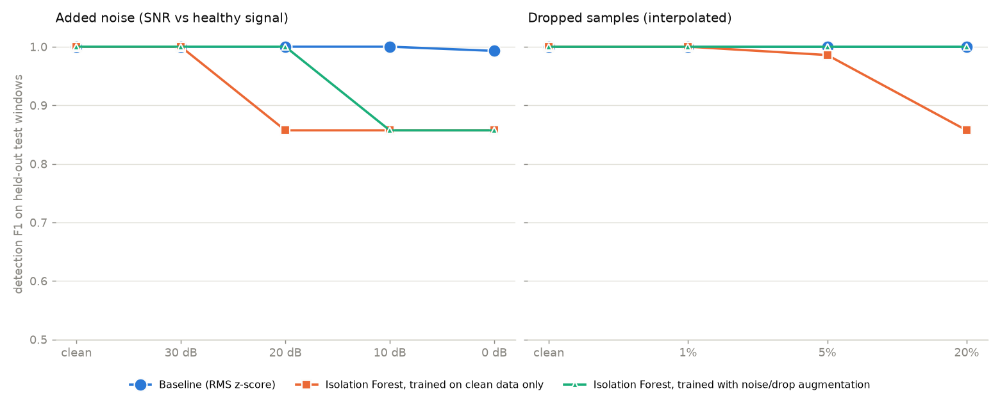

# MachinaSense evaluation

Data: `cwru`, held-out test split (184 windows of 2048 samples). Thresholds were tuned on the validation split only.

## Detection: baseline vs model

| detector (+ RF for fault type) | precision | recall | f1 | false_alarm_rate | end_to_end_macro_f1 |
|---|---|---|---|---|---|
| Baseline (RMS z-score) | 1.000 | 1.000 | 1.000 | 0.000 | 1.000 |
| Isolation Forest | 1.000 | 1.000 | 1.000 | 0.000 | 1.000 |

## Fault classification (Random Forest, true fault windows)

|  | precision | recall | f1 | support |
|---|---|---|---|---|
| ball | 1.000 | 1.000 | 1.000 | 46.000 |
| inner_race | 1.000 | 1.000 | 1.000 | 46.000 |
| outer_race | 1.000 | 1.000 | 1.000 | 46.000 |
| macro avg | 1.000 | 1.000 | 1.000 | 138.000 |

## End-to-end (Isolation Forest -> Random Forest)

|  | precision | recall | f1 | support |
|---|---|---|---|---|
| normal | 1.000 | 1.000 | 1.000 | 46.000 |
| ball | 1.000 | 1.000 | 1.000 | 46.000 |
| inner_race | 1.000 | 1.000 | 1.000 | 46.000 |
| outer_race | 1.000 | 1.000 | 1.000 | 46.000 |
| macro avg | 1.000 | 1.000 | 1.000 | 184.000 |

## Severity of alerts per true class

| true label | none | low | medium | high |
|---|---|---|---|---|
| normal | 46 | 0 | 0 | 0 |
| ball | 0 | 0 | 46 | 0 |
| inner_race | 0 | 0 | 0 | 46 |
| outer_race | 0 | 0 | 0 | 46 |

## Robustness to noise and dropped samples

Models are trained on the training split only; the test split is corrupted. Noise SNR is relative to the healthy machine's signal level (0 dB = noise as strong as the healthy vibration). Dropped samples are linearly interpolated by the pipeline, except the 'zero-filled (naive)' row. `no_aug` columns are the same pipeline trained without noise/drop augmentation.

| condition | baseline_f1 | baseline_false_alarm | iforest_f1 | iforest_false_alarm | end_to_end_macro_f1 | iforest_no_aug_f1 | iforest_no_aug_false_alarm | end_to_end_no_aug_macro_f1 |
|---|---|---|---|---|---|---|---|---|
| clean | 1.000 | 0.000 | 1.000 | 0.000 | 1.000 | 1.000 | 0.000 | 1.000 |
| noise 30 dB | 1.000 | 0.000 | 1.000 | 0.000 | 1.000 | 1.000 | 0.000 | 1.000 |
| noise 20 dB | 1.000 | 0.000 | 1.000 | 0.000 | 1.000 | 0.857 | 1.000 | 0.667 |
| noise 10 dB | 1.000 | 0.000 | 0.857 | 1.000 | 0.667 | 0.857 | 1.000 | 0.667 |
| noise 0 dB | 0.993 | 0.043 | 0.857 | 1.000 | 0.667 | 0.857 | 1.000 | 0.667 |
| drop 1% | 1.000 | 0.000 | 1.000 | 0.000 | 1.000 | 1.000 | 0.000 | 1.000 |
| drop 5% | 1.000 | 0.000 | 1.000 | 0.000 | 1.000 | 0.986 | 0.087 | 0.978 |
| drop 20% | 1.000 | 0.000 | 1.000 | 0.000 | 1.000 | 0.857 | 1.000 | 0.667 |
| drop 20% zero-filled (naive) | 1.000 | 0.000 | 0.857 | 1.000 | 0.667 | 0.857 | 1.000 | 0.667 |
| noise 20 dB + drop 5% | 1.000 | 0.000 | 1.000 | 0.000 | 1.000 | 0.857 | 1.000 | 0.667 |

